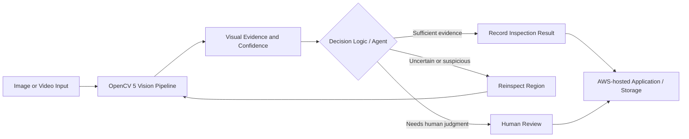

# Visora AI — Conceptual Architecture

> Update this diagram if the final implementation differs. Only label components as implemented after verifying them.

## Components to document
- **Input:** supported image/video formats and upload limits.
- **OpenCV 5:** the actual image/video operations used and why they matter.
- **Decision loop:** explain how a visual result changes the next action or tool call.
- **Human review:** describe when it is requested and how the reviewer responds.
- **AWS:** list only the services actually used, including deployment configuration.
- **Observability:** document logs, errors, and evaluation records.
